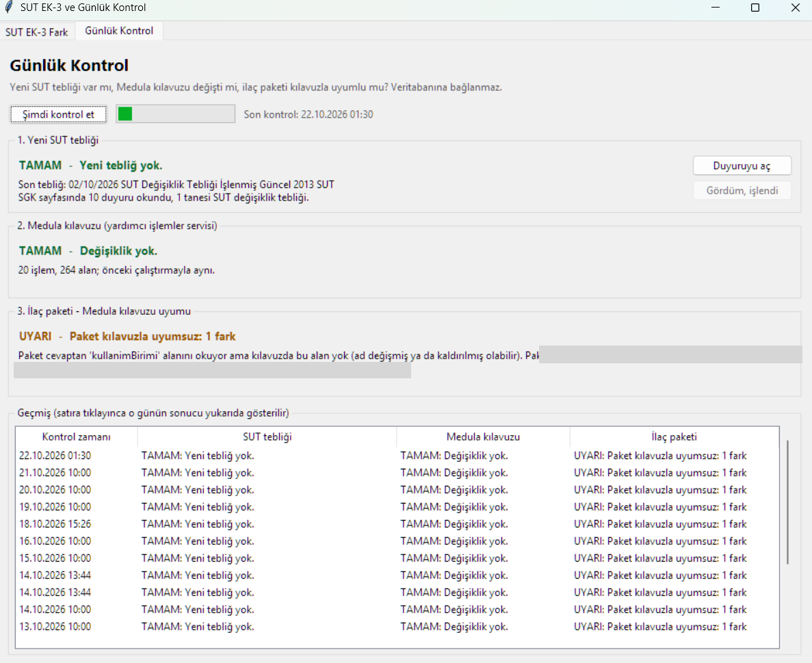
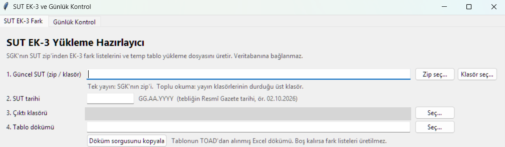

# Healthcare Regulatory Change Monitor

**A daily early-warning tool that detects changes in Turkish national health regulations and service contracts before they break a hospital information system.**

> Case study. This tool was built for internal use; source code is not published. This write-up describes the problem, the approach and the outcome.

---

## The problem
A hospital information system (HBYS) in Türkiye depends on public rules and services that change without much notice:

- **SUT (Health Implementation Communiqué)** — the national reimbursement rulebook. Its annexes list thousands of medical supply codes with descriptions and prices. Every amendment can add, remove or reprice items.
- **SGK Medula web services** — the national insurance system that hospitals call for drug and billing operations. When a field in a service contract is renamed, any integration still using the old name silently fails.

These changes were followed manually: someone had to notice a new publication, download it, compare it line by line and update the database by hand. Price differences could stay unnoticed for months, and an integration break was often noticed only when users reported errors.

## What I built
A small desktop application (two tabs) that runs automatically **every morning at 10:00** and opens a single check screen — whether or not anything changed, so checking becomes a habit.

It performs three checks:

### 1. New regulation detection
Checks the official publication page for a new SUT amendment and remembers what has already been seen. New publications are flagged on screen.

### 2. Supply price & code reconciliation
When a new amendment is published:
- Loads the official annex lists (code, description, price, effective date — taken from the official file names)
- Compares them with the prices currently in the hospital database
- Classifies every difference as **added**, **removed** or **changed** (price or description)
- Applies agreed business rules, e.g. items moved into a bundled procedure get price 0 from the effective date; codes missing from the first list of the year are marked as removed from 1 January
- Produces a **review Excel** for the team and a **date-stamped insert script** for the database update

What used to be a manual, error-prone task became a repeatable one-click process — with a human review step before anything is written to production.

### 3. Web service contract monitoring
- Reads the service's WSDL and its externally imported XSD schema (where the real field definitions live)
- Compares the current contract with the last known version and reports **added, removed or renamed fields**
- A second mode cross-checks the fields used by our own integration code, so we know which changes actually affect us

**Real catch:** the tool detected that a field in the drug search response had been renamed (e.g. a unit field replaced by a pack-total-quantity field) — confirmed afterwards by the provider's own changelog — before it caused production errors.

## Design choices
- **Read-only by default.** The tool never writes to production; it produces scripts and lists that go through review.
- **One screen, every day.** Several separate scheduled tasks were merged into one, so there is a single place to look.
- **Built for non-developers.** A simple launcher and folder picker; no command line needed.
- **Split into a general and a specific check,** so other teams can monitor any service-wide change without our integration code.

## Tech
Python · pandas · Excel automation · WSDL/XSD parsing (SOAP) · Windows Task Scheduler · Oracle (SQL scripts)

## Next steps
- RAG layer over historical SUT publications: ask "what is the current price of code X and how did it change over time?"
- Side-by-side price history across publication dates

## Screenshots
**Daily check screen** — new regulation, web service contract and integration compatibility, with a history of past runs:

**Supply list reconciliation** — pick the official package, set the publication date, get the difference lists and the update script:

*Interface is in Turkish. File names and paths are blurred.*
